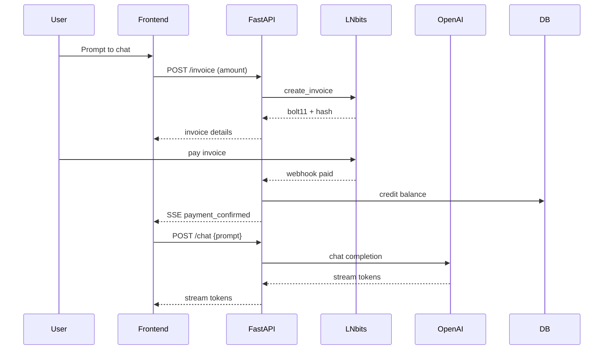

# SatsAi Agent

## Objective

Build and operate a self‑hosted web application where users unlock access to OpenAI models by paying with the Bitcoin Lightning Network. Emphasise modular clean architecture, privacy‑first operations, and full Git workflow.

## Responsibilities

1. Generate Lightning invoices (via LNbits or BTCPay Server) and track settlement in real‑time.
2. Credit user accounts upon payment and persist balances/usage in PostgreSQL.
3. Proxy user requests to OpenAI APIs (GPT‑4o, GPT‑4, Whisper, TTS) with streaming responses.
4. Enforce per‑user rate limits and usage quotas.
5. Send operational alerts and usage summaries to Telegram.
6. Expose a minimal REST/SSE API consumed by the React+Tailwind frontend.

## Tech Stack (Authoritative)

| Layer             | Primary Tools                                    |
| ----------------- | ------------------------------------------------ |
| **Frontend**      | React 19 + Vite + Tailwind 4, Zustand, SSE hooks |
| **Backend**       | FastAPI, Async SQLAlchemy, Pydantic‑Settings v2  |
| **Lightning**     | LNbits (REST & WebSocket) • alt: BTCPay Server   |
| **Database**      | PostgreSQL 15 (encrypted at rest)                |
| **Infra**         | LXC containers on Proxmox • Tailscale mesh       |
| **CI/CD**         | GitHub Actions → self‑hosted runner              |
| **Observability** | Prometheus, Grafana, Sentry                      |

## Allowed ENV Secrets

* `OPENAI_API_KEY`
* `LNBITS_KEY`
* `DATABASE_URL`
* `TELEGRAM_BOT_TOKEN`
* `SENTRY_DSN`

## Hard Constraints

* **Privacy:** Never log prompts, responses or wallet pubkeys unencrypted.
* **Rate‑limiting:** 50 requests / min per user, 1000 requests / IP.
* **Deployment:** `docker compose up` (single command) must spin the full stack.
* **Language:** Default responses in Brazilian Portuguese; fallback to English if `Accept‑Language` ≠ `pt‑BR`.
* **Data retention:** Delete unpaid invoices after 30 days; anonymise usage logs after 90 days.

## Tools

| Name                          | Method & Endpoint                                 | Purpose                     |
| ----------------------------- | ------------------------------------------------- | --------------------------- |
| `lnbits.create_invoice`       | `POST /api/v1/payments`                           | Create Lightning invoice    |
| `lnbits.check_invoice`        | `GET  /api/v1/payments/{hash}`                    | Check invoice status        |
| `openai.chat_completions`     | `POST https://api.openai.com/v1/chat/completions` | Stream GPT‑4o text          |
| `openai.audio.transcriptions` | `POST /v1/audio/transcriptions`                   | Whisper speech‑to‑text      |
| `db.*`                        | Async SQLAlchemy                                  | Balance, usage & audit logs |
| `telegram.send_message`       | `POST https://api.telegram.org/bot…/sendMessage`  | Owner notifications         |

## Typical Flow

## Non‑Goals

* On‑chain BTC payments or fiat gateways.
* Full‑fledged user management (OAuth). Session cookies only.
* Handling refunds; Lightning payments are final.

## Future Extensions

1. Nostr NIP‑47 keysend integration for log‑in.
2. Voice‑first UX with real‑time TTS + Whisper.
3. Subscription tiers managed via LNbits extensions.

## Version

`0.1.0` — June 15 2025
